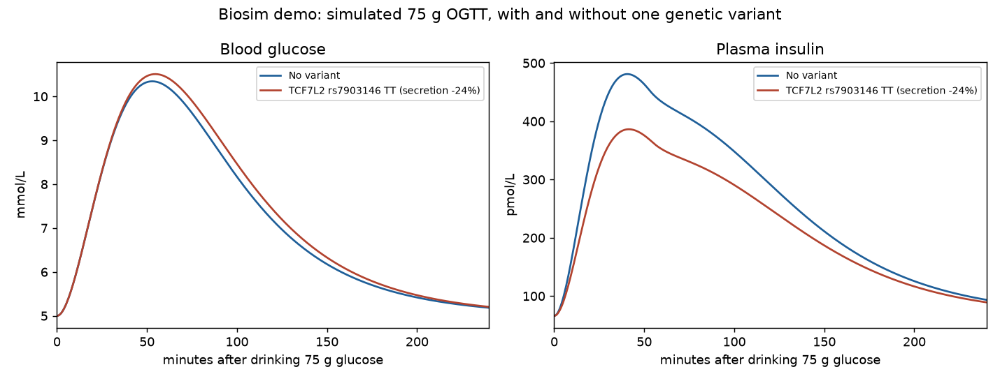
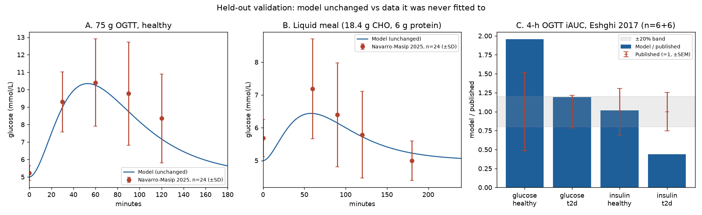

# Biosim

[](https://github.com/Prometh1on/biosim/actions/workflows/tests.yml)

Biosim is a systems-biology simulator for postprandial glucose/insulin
dynamics. Given a meal, a set of physiological parameters, and (optionally)
genetic variants, it integrates a system of ODEs to predict how blood glucose
and insulin evolve over time, and turns that prediction into both a
quantitative report and a plain-language summary.

> **Not medical advice.** Biosim is a research and learning project. Its outputs are
> simulations, most of its drug modules are unvalidated, and it fails its one blind test
> (see [Validation](#validation)). Do not use it to make decisions about anyone's health,
> diet or medication.

**How it was built.** Biosim is AI-assisted: most of the code was written with an AI coding
assistant (Claude Code), under my direction and review, and I'm still learning the codebase.
Citations are checked against PubMed (the few that could not be verified are marked
UNVERIFIED in the code), and the validation results below, including the
failures, are reported as they came out.

## One-command demo

After [Setup](#setup), from the repo root with the virtualenv active:

```bash
python scripts/demo.py
```

It simulates a 75 g oral glucose tolerance test for a default healthy adult, and again for
someone carrying two copies of the TCF7L2 rs7903146 risk allele. It saves the figure to
`outputs/demo_ogtt_variant.png`, a gitignored folder, so running the demo never changes a
tracked file. The committed copy below is `docs/figures/demo_ogtt_variant.png`; to regenerate
it, run `python scripts/demo.py docs/figures/demo_ogtt_variant.png`.



The variant lowers the simulated insulin peak by about 20% but raises the glucose peak only a
little (10.3 → 10.5 mmol/L). The per-allele effect size is this project's own modelling
choice, not a measured value. Everything is simulated; no personal data is used.

The core scientific claim the platform is built around: the same meal
produces a measurably different glucose response depending on time of day,
prior exercise, genetic variants, medications, and disease state. Biosim
models each of those factors explicitly rather than treating them as noise.

Modeled conditions include GLP-1 and GIP/GLP-1 agonists (semaglutide,
liraglutide, tirzepatide), DPP-4 and SGLT2 inhibitors, metformin,
sulfonylureas, alpha-glucosidase inhibitors, exogenous insulin, corticosteroids
and several other drugs, twelve disease states (including type 1 and type 2
diabetes, CKD, PCOS, OSA and NAFLD), circadian variation, sleep, type 2 diabetes
genetic risk, and exercise.

## How it works

At the center is the Bergman minimal model -- three coupled ODEs for glucose,
insulin and remote insulin action -- plus three insulin-driven read-outs
(IGF-1, mTOR, AMPK). The read-outs respond to insulin but do not feed back into
glucose or insulin, so they never change the glucose/insulin prediction:

```
Coupled core:          G (glucose, mM), I (insulin, pM), X (remote insulin action, min⁻¹)
Insulin-driven
read-outs (no feedback): IGF1 (nM), mTOR (0-1), AMPK (0-1)
```

Meal absorption is a two-compartment first-order (stomach -> gut -> plasma)
curve: glucose appearance starts at zero when you eat and peaks later. A meal
with no glycaemic index (GI) uses the same rate constants as the 75 g OGTT
(a labelled **model assumption**: no mixed-meal source was found). Setting
`kabs` on a meal selects the older single-exponential curve instead. The GI
timing adjustment is an **unvalidated placeholder**: only GI=100 (pure
glucose) is calibrated, and any run that uses another GI says so in its
warnings and plain-language report.

Optional pathway extensions couple onto this core system through a fixed set
of named signals (e.g. `p3_modifier`, `hepatic_egp_delta`, `incretin_effect`)
rather than by modifying the core equations directly. Each extension has a
neutral default so it has zero effect unless explicitly activated by a
scenario:

| Extension | Represents | Activated by |
|---|---|---|
| Cortisol | HPA-axis / stress / exogenous steroids | `stress_level` or a glucocorticoid drug event |
| Hepatic glucose production | Endogenous glucose output, T2D and metformin effects | T2D disease state and/or metformin |
| NEFA | Free fatty acid-driven insulin resistance | Opt-in (`model_nefa_dynamics`) |
| GLP-1 | Incretin effect, gastric emptying | Semaglutide, liraglutide, DPP-4 inhibitors |
| Exercise | During/after-exercise insulin sensitivity | An in-progress or recent exercise bout |

A separate Boolean/hybrid model runs alongside the ODE as a consistency
watchdog — it never blends with or overrides the ODE's own output.

On top of the ODE core, a personalization pipeline applies (in order) age,
sex, BMI, fitness, disease state, circadian time-of-day, drug interactions,
exercise, and genetic variants, composing multiplicatively into the model's
parameters.

## Validation

**Summary.**
- **Held-out data:** 7 of 12 points within ±20% on the first run.
- **Pre-registered blind test:** 1 of 11.
- **Drugs:** semaglutide VALIDATED with a caveat; the other 22 drug modules EXPERIMENTAL.

### Pre-registered blind test (H2): 1 of 11

Before any run, three published datasets that no part of the project had used were written
down, along with the model setup and the scoring rule (±20%). The datasets are a 75 g OGTT and
a bread meal in 14 healthy adults each, and a 75 g OGTT in 785 young adults. The model was then
run once, unchanged. **1 of 11 points landed within ±20%, and all three datasets missed.**
This is the project's only first-contact result.

The model gets the first 30–45 minutes after a load about right, but glucose stays high too
long. By 90–120 minutes its rise above fasting is 2.5–4× the published value. One-factor
sensitivity runs point mainly to glucose being cleared too slowly after an oral load. That
analysis is post-hoc, and nothing was changed. Any fix has to be pre-registered and tested on
fresh data. Details: [docs/VALIDATION.md](docs/VALIDATION.md), section 8 and "Why H2 missed".

### Held-out data (B2): 7 of 12

The model was run, unchanged, against three published datasets it was never fitted to (a
75 g OGTT and a liquid mixed meal in 24 healthy adults, and a 4-hour OGTT in 6 healthy men
and 6 men with type 2 diabetes). **On that first, truly held-out run, 7 of 12 points landed
within ±20% of the published mean, and 1 of the 3 datasets passed in full.** The run pointed to
a double-counted glucose-clearance term, which was then removed (B7, nothing re-tuned). After
that, 10 of 12 points and 2 of 3 datasets pass, but those datasets had already been seen, so
that is not a new held-out result. Still missing: the healthy 4-hour glucose area (+95%) and
the type 2 diabetes insulin response (−56%). The fix made the in-house OGTT benchmark (whose
constants were fitted with the double count in place) worse: PASS → FAIL (its one remaining
scored NORMAL point, peak glucose, is +33%). Details, the list
of everything the model was fitted to, the before/after table and a figure:
[docs/VALIDATION.md](docs/VALIDATION.md).



## Drug modules: one validated, the rest experimental

A drug is labelled VALIDATED only if every point of a cited clinical benchmark
for it came within ±20% of the published value, that benchmark was not used to
fit any part of the model, and a person has reviewed it.

**Semaglutide is VALIDATED, with a caveat.** Its one benchmark point (glucose
iAUC reduction, 1 mg, Hjerpsted et al. 2018, n=30) is +0.7% from the published
value, and it was reviewed on 2026-11-21. But the match depends on population assumptions: it holds for the default healthy adult and
default 75 g meal, but modelling the trial's obese population (Hjerpsted et al. 2018,
PMID 28941314; BMI 30 / 35) gives −26% / −39%, and 50 g / 100 g meals give −34% / +34%.
So the match is not robust to modelling the trial's own population. The caveat
is stored with the label and shown wherever the label is.

Every other drug is labelled **EXPERIMENTAL**; none comes close to the rule.
Drug runs still work. A simulation that applies a drug carries a note in its
`warnings` (so also in each output of a batch or comparison), in the REST
`/simulate` and `/population` responses, and in the plain-language report:
"EXPERIMENTAL drug module" for an experimental drug, or "VALIDATED drug
module" plus the caveat for semaglutide. Comparison narratives do not repeat it.
The `/validation` drug benchmarks carry the same label (their PASS/MISS
verdicts are unchanged). The status lives in one table:
`packages/physiology/src/biosim_physiology/drug_interactions/validation_status.py`.

| Drug(s) | Clinical benchmark | Model vs published | Verdict | Status |
|---|---|---|---|---|
| semaglutide | glucose iAUC reduction, 1 mg | +0.7% (one point; −26% to −39% if the trial's obese population is modelled) | PASS | VALIDATED (with caveat) |
| glucocorticoid (prednisone) | glucose AUC increase, 40 mg, T2D | −68.2% | MISS | EXPERIMENTAL |
| metformin | glucose iAUC reduction, T2D | −30.6% | PASS, but only inside a wide ±50% band | EXPERIMENTAL |
| dapagliflozin | SGLT2-inhibitor glucose / insulin AUC (canagliflozin data) | −84.9% / −81.3% | MISS | EXPERIMENTAL |
| caffeine | insulin AUC increase, healthy / T2D | −97.8% / −99.7% (right direction, about +1% vs +25–60%) | MISS | EXPERIMENTAL |
| empagliflozin | none of its own (class benchmark above misses) | — | none registered | EXPERIMENTAL |
| alcohol, liraglutide, DPP-4 inhibitor, tirzepatide, glibenclamide, glipizide, glimepiride, acarbose, miglitol, regular insulin, insulin lispro, pioglitazone, indinavir, hydrochlorothiazide, growth hormone, atorvastatin, hydroxychloroquine | none registered | — | none registered | EXPERIMENTAL |

## Package structure

Each package lives under `packages/<name>/src/<module>/` and is added to
`sys.path` individually (see [Setup](#setup) below) rather than installed as a
distributable Python package.

| Package | Module | Responsibility |
|---|---|---|
| `id-resolver` | `biosim_id_resolver` | Canonical IDs and cross-references for proteins, metabolites, and pathways (UniProt, ChEBI, HMDB, Reactome, KEGG) |
| `parameter-db` | `biosim_parameter_db` | Append-only kinetic parameter store with confidence tiers and provenance |
| `literature-pipeline` | `biosim_literature` | Fetches and normalizes kinetic parameters from PubMed literature |
| `curation` | `biosim_curation` | Expert-review priority queue for model parameters |
| `ode-engine` | `biosim_ode` | The core ODE system and pathway extensions |
| `uncertainty` | `biosim_uncertainty` | Monte Carlo uncertainty quantification, sensitivity analysis, confidence bands |
| `genotype` | `biosim_genotype` | Maps GWAS variants to parameter modifiers (privacy-preserving) |
| `physiology` | `biosim_physiology` | Age/sex/BMI/fitness/disease/circadian/drug/exercise modifiers |
| `simulation-api` | `biosim_api` | Scenario definitions and the end-to-end simulation pipeline |
| `expert-tools` | `biosim_expert` | SBML export, batch runs, CSV export, sensitivity reporting |
| `lay-output` | `biosim_lay` | Food database and plain-language, traffic-light-style reports |
| `validation` | `biosim_validation` | Validation against published clinical benchmark data |
| `infrastructure` | `biosim_infra` | Simulation cache, privacy auditing, reproducibility bundles |
| `data-seeds` | `biosim_seeds` | Literature-derived parameter seeds and prebuilt scenarios |
| `rest-api` | `biosim_rest` | FastAPI HTTP layer over `simulation-api` |
| `metabolism` | `biosim_metabolism` | Offline stoichiometric hepatic network and flux variability analysis (Track 4) |
| `context-registry` | `biosim_context_registry` | Registry for disease states and other non-molecular context entities |

## Setup

Requires Python 3.14 (the version `pyproject.toml` pins and the project is tested on).

**Windows (PowerShell)**

```powershell
git clone https://github.com/Prometh1on/biosim.git
cd biosim
py -3.14 -m venv .venv
.venv\Scripts\Activate.ps1
python -m pip install -r requirements-lock.txt
```

If PowerShell refuses to run `Activate.ps1` because of its execution policy, skip activation and
call `.venv\Scripts\python.exe` directly instead of `python`.

**macOS / Linux**

```bash
git clone https://github.com/Prometh1on/biosim.git
cd biosim
python3.14 -m venv .venv
source .venv/bin/activate
python -m pip install -r requirements-lock.txt
```

Two dependency files:

- `requirements-lock.txt` pins every package to the exact version the suite was last run
  with. Use it for a reproducible install. CI installs from it.
- `requirements.txt` lists only the direct dependencies, with minimum versions. Use it if you
  want newer versions; the lock file is regenerated from it (instructions in its header).

There are no per-package manifests — packages are not `pip install`-ed
individually. Instead, `conftest.py` at the repo root inserts each package's
`src/` directory onto `sys.path` at test-collection time, and does the same
for any script run from the repo root via pytest. If you need the packages
importable outside of pytest (e.g. in a plain Python REPL or script), either
run it through pytest, or replicate what `conftest.py` does by adding the
relevant `packages/<name>/src` paths to `PYTHONPATH` yourself.

## Running tests

With the virtualenv active (same command on Windows, macOS and Linux):

```bash
python -m pytest --tb=short -q
```

CI ([.github/workflows/tests.yml](.github/workflows/tests.yml)) runs the same suite on Ubuntu
and Windows with Python 3.14, installing from `requirements-lock.txt`. It adds
`-W error::pytest.PytestRemovedIn10Warning` so pytest-10 deprecations fail the build. It then
runs the demo and checks that no tracked file changed.

Tests live under each package's own `tests/` directory and are collected
repo-wide via the `testpaths = ["packages", "scripts"]` setting in `pyproject.toml`.

A small number of tests are marked `integration` and require live external
credentials (e.g. a real `ANTHROPIC_API_KEY` for literature-ingestion
end-to-end tests) — they're skipped automatically when the credential isn't
present.

Other useful checks, all configured in `requirements.txt`:

```bash
pytest --cov=packages --cov-report=term-missing   # coverage report
ruff check .                                        # lint
mypy packages --ignore-missing-imports              # type check
bandit -r packages --exclude "*/tests/*,*/__pycache__/*"  # security scan
pip-audit -r requirements.txt                       # dependency vulnerabilities
```

## Quick usage example

Run this from the repo root. The first line puts every `packages/*/src` on `sys.path`, the
same way the tests and `scripts/demo.py` do:

```python
import conftest  # noqa: F401  (adds packages/*/src to sys.path)
from biosim_seeds import PlatformSession

session = PlatformSession()
output = session.simulate("high_sugar_meal")
report = session.report(output)
print(report.glucose_section)
```

Other built-in scenarios include `standard_meal`, `light_snack`, `fasted`,
`ogtt_75g`, `caffeine_and_meal`, plus drug/condition scenarios such as
`semaglutide_scenario`, `stress_meal_scenario`, and `type2_diabetes_meal_scenario`
(see `biosim_seeds`).

## REST API

`rest-api` exposes the simulation pipeline over HTTP via FastAPI. The packages are not
installed, so put their `src` folders on `PYTHONPATH` first. From the repo root:

```powershell
# Windows PowerShell
$env:PYTHONPATH = (Get-ChildItem packages\*\src | ForEach-Object FullName) -join ';'
uvicorn biosim_rest.app:create_app --factory --reload
```

```bash
# macOS/Linux
export PYTHONPATH=$(ls -d "$PWD"/packages/*/src | paste -sd: -)
uvicorn biosim_rest.app:create_app --factory --reload
```

| Endpoint | Purpose |
|---|---|
| `POST /simulate` | Run a scenario and return a simulation result (cached) |
| `GET /scenarios` | List available scenarios |
| `POST /compare` | Compare two scenarios |
| `GET /validation` | Run all registered clinical benchmarks and report PASS/MISS/WARN/FAIL (or NO DATA when no cited point exists) with each point's deviation |
| `GET /health` | Health check |

Interactive API docs are available at `/docs` once the server is running.

## License

Apache License 2.0 — see [LICENSE](LICENSE).
