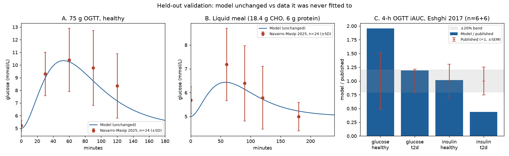

# Validation: how well does the model match data it never saw?

Written 2026-11-16 (finish-plan item B2). Model code unchanged by this work: no parameter
was tuned. Re-run with `ModelValidator().validate_heldout()`; regenerate the figure with
`.venv\Scripts\python.exe scripts\plot_heldout.py`.

## Why this matters

Until now, every benchmark this model "passed" had a catch. The OGTT benchmark is partly
circular: the gut-absorption constants and the first-phase insulin gain were fitted to it.
A model can always match the data it was fitted to. The honest test is data it was **never**
fitted to, run with the model **unchanged**. That is what this page reports.

"Held-out" here means *different data*, not a different kind of test: dataset A is the same
protocol (a 75 g OGTT) as the benchmark the absorption constants were fitted to, and the liquid
meal (B) has no glycaemic index, so it uses those same OGTT-fitted absorption constants
(`GutAbsorptionModel.default_meal()`). The kinetics were tuned on other people's data of the
same type.

## 1. Calibration inventory: what the model was fitted to

These are the sources used to fit, calibrate or check the model before this test. A held-out
dataset must not be any of them (`CALIBRATION_SOURCE_PMIDS` in
`packages/validation/src/biosim_validation/heldout.py`; a test also checks against every seeded
parameter's source and every existing benchmark's source).

| What was fitted or anchored | Source (PMID) | How |
|---|---|---|
| Gut absorption rate constants (`ogtt_calibrated_glucose`, also the default meal) | Van Cauter 1992 (1566835); the 2-hour point was cited to DeFronzo 1979 (382871), the wrong paper, and is unsourced and unscored since B4 | **Fitted** (least squares) to 3 OGTT glucose points |
| First-phase insulin gain (121.3) | same OGTT benchmark | **Fitted** |
| p3 (insulin action), IVGTT benchmark | Bergman 1981 (7033284) | Quoted value; benchmark |
| p2, ke, p1 | MINMOD (3640682), Sherwin 1974 (4856884), Pacini 1998 (9575818) | Quoted / range check |
| Beta-cell glucose sensing (KG_secretion) | Rebelato 2018 (30166558) | Derived |
| First-phase functional form | Mari 2002 (12388151) | Form only |
| Glucose distribution volume | Mora-Gonzalez 2024 (38389141) | Quoted |
| Hepatic first-pass extraction | Radziuk 1978 (651653) | Quoted |
| **T2D glucose effectiveness ×0.56** | **Basu 2009 (19196896)** | Quoted, **same cohort as the T2D meal-insulin benchmark** |
| T2D liver glucose output | Beck-Nielsen 2002 (12643178) | Derived |
| GLP-1 meal response | Orskov 1994 (8138058) | Calibrated |
| Acarbose, miglitol absorption slowing | Chen 2016 (27686734), Samad 1988 (3042310) | Calibrated |
| Protein-driven insulin secretion | Krezowski 1986 (3538843), Nuttall 1984 (6389060) | Calibrated |
| Drug and caffeine benchmarks | 28941314, 32369480, 39049802, 23412078, 33515092, 11478588, 15465742 | Benchmarks |

**Values with no source at all** (labelled MODEL ASSUMPTION in the code) that affect the
held-out runs (at the B2 baseline): `extra_g_clearance` 0.018/min (removed in B7), `G_threshold` 4.5 mM, and the T2D preset's
secretion ×0.60, insulin action ×0.55 and fasting glucose ×1.30.

**T2D calibration overlap.** The T2D glucose-effectiveness factor (0.56) was taken from Basu
2009, and the `validate_t2d_meal_insulin` benchmark uses the same Basu 2009 cohort. Those
benchmark points are therefore **partly circular**: one T2D parameter was read from the data
they are scored against. (The insulin misses there are not caused by this; they were already
present.) The held-out T2D data below come from a different study.

## 2. Held-out datasets

All values were read from full text fetched from Europe PMC on 2026-11-16, and each point's
`notes` field quotes the table row it came from.

| Dataset | Source | People | Protocol | Used |
|---|---|---|---|---|
| A | Navarro-Masip et al. 2025, *Int J Mol Sci*, PMID 40564902, Table 2 | 24 healthy non-obese adults, age 53 ± 17, BMI 24.8, 12 M / 12 F | 75 g OGTT, samples 0-120 min every 30 min | glucose (mean ± SD) |
| B | same paper, same people | as A | liquid meal: 18.4 g carbohydrate, 6 g protein, 5.8 g fat (Fortisip), samples to 180 min | glucose |
| C | Eshghi et al. 2017, *Front Endocrinol*, PMID 28744255, Table 5 | 6 healthy men (age 43) and 6 men with T2D (age 61, A1c 6.4%) | 75 g OGTT, 4 h, 10 samples; rest (no-exercise) arm | glucose and insulin iAUC (mean ± SEM) |

**Two data problems, stated plainly:**
- In dataset A/B the glucose row is labelled "mmol/L" but the values (94-188) only make
  sense as mg/dL; Table 1 of the same paper gives the identical fasting value labelled
  "mg/dL" (100.4 ± 10.8). So they were converted (÷18.016).
- The same table labels insulin "pmol/L", but a fasting mean of 13 matches µU/mL instead.
  The text does not settle it, so **insulin from that paper is not used**.

**How the model was run:** default parameters for the population (healthy, or the T2D preset),
nothing adjusted. Fasting values are not scored: they are the model's starting point, not a
prediction. The model is sampled at the study's own time points, and iAUC is computed the way
the paper did it: the trapezoid area minus the fasting value × the duration.

**Headline band: ±20%** of the published mean (`Tolerance.STRICT`). The verdict uses the
same PASS / MISS / NO DATA logic as every other benchmark.

## 3. Results (B2 baseline: the true out-of-sample test, before B7)

This table is the model as it was when these datasets were first used (commit 50e9661).
It is the real held-out result. Section 6 shows what changed after the B7 fix; because these
datasets had already been seen by then, the section 6 numbers are "seen", not held-out.

| Dataset | Point | Published | Model | Error | Within ±20%? |
|---|---|---|---|---|---|
| A. OGTT, healthy | glucose 30 min | 9.30 mM | 8.36 | −10.1% | yes |
| | glucose 60 min (highest sample) | 10.41 | 8.93 | −14.2% | yes |
| | glucose 90 min | 9.77 | 7.62 | −22.0% | **no** |
| | glucose 120 min | 8.35 | 6.46 | −22.6% | **no** |
| **A verdict** | | | | | **MISS** (2 of 4 points) |
| B. Liquid meal | glucose 60 min | 7.18 mM | 6.05 | −15.8% | yes |
| | glucose 90 min | 6.39 | 5.75 | −10.1% | yes |
| | glucose 120 min | 5.79 | 5.44 | −6.1% | yes |
| | glucose 180 min | 5.00 | 5.12 | +2.5% | yes |
| **B verdict** | | | | | **PASS** (4 of 4) |
| C. 4-h OGTT | glucose iAUC, healthy | 269 mM·min | 389 | +44.5% | **no** |
| | glucose iAUC, T2D | 902 | 588 | −34.8% | **no** |
| | insulin iAUC, healthy | 47,004 pM·min | 38,152 | −18.8% | yes |
| | insulin iAUC, T2D | 20,144 | 5,741 | −71.5% | **no** |
| **C verdict** | | | | | **MISS** (1 of 4) |

**Summary: 7 of 12 held-out points within ±20%; 1 of 3 datasets passes.** (No separate
peak or time-to-peak points: the highest sample *is* the 60-min value, and with 30-minute
sampling a ±20% time band only admits 60 min, so those would double-count or pass trivially.)

**The same numbers as rises above fasting.** The ±20% headline compares absolute glucose,
which flatters the model when a cohort's fasting glucose differs from the model's 5.0 mM
(cohort A 5.22, cohort B 5.68 mM). As the rise above each cohort's own fasting value:

| Dataset | Point | Published rise | Model rise | Error |
|---|---|---|---|---|
| A. OGTT | 30 / 60 / 90 / 120 min | +4.07 / +5.18 / +4.55 / +3.13 mM | +3.36 / +3.93 / +2.62 / +1.46 | −18% / −24% / −42% / −53% |
| B. Liquid meal | 60 / 90 / 120 / 180 min | +1.50 / +0.71 / +0.11 / −0.69 mM | +1.05 / +0.75 / +0.44 / +0.12 | −30% / +5% / rise ~0 / below fasting |

So dataset B's PASS is partly a baseline coincidence: at 180 min the cohort is *below* its own
fasting value, which the model (which can only return to 5.0) cannot reproduce. In rise terms
the model's OGTT response is clearly too small after the first hour.

What the misses say:
- **The model clears glucose too fast after an OGTT** (A: 90 and 120 min are 22% low).
  Cohort A is older (mean age 53) and its 2-hour mean (8.3 mM) is above the usual healthy
  range, so part of this is the cohort; but the IVGTT diagnosis below points the same way.
- **The T2D preset does not fit this T2D cohort** (C): insulin iAUC 72% too low and glucose
  iAUC 35% too low. The cohort is mild, early T2D (A1c 6.4%, 3.9 years since diagnosis,
  normal BMI), treated with metformin that was withheld before the study days, while the
  preset is a generic one whose secretion (×0.60) and insulin-action (×0.55) factors have no
  source. So the preset's beta-cell defect looks too severe for early T2D. One cohort of 6 is
  not enough to say the factors are wrong in general. Both glucose and insulin being too low
  is not explained by one simple cause (too little secretion alone would raise glucose).
- **Healthy glucose iAUC is 45% too high** (C) even though the healthy insulin iAUC is close.
  With n=6 the published SEM is ±51% of the mean (138/269), so this single point is weak evidence.
- **The liquid meal passes.** It is a small meal (18.4 g carbohydrate), where errors are small
  in absolute terms, so this is the easiest test of the three.

## 4. The IVGTT −45%: diagnosis (fixed in B7, see section 6)

`validate_bergman_iv` reports the time for glucose to come back within 10% of baseline after a
20 g IV glucose bolus: model 49.6 min vs reference 90 min (−45%). Two causes were found by
running the model with single changes (nothing committed):

1. **The benchmark is weak.** Its reference comes from the note "Bergman 1981 Fig 1: glucose
   returns to baseline by ~90-120 min". It is a reading from a figure, and the 2026-11-15
   provenance audit could not check it (abstract only). It also measures something different:
   "returns to baseline" vs the code's "enters a ±10% band". With a ±2% band the model gives
   78.6 min (−13%).
2. **The model clears glucose too fast without insulin.** `extra_g_clearance` = 0.018/min
   ("renal etc.", no source) is added on top of `p1` = 0.0317/min. But in the minimal model,
   p1 (S_G) already stands for *all* insulin-independent glucose disposal, so the extra term
   likely counts the same thing twice. Together they give 0.0497/min, and the time for the
   bolus excess to decay into the band at that rate, ln(6.9/0.5)/0.0497 = 52.8 min, is the
   model's own result with insulin action switched off. In the model as it is, insulin action
   adds only ~3 minutes; with the extra term removed it adds ~13 minutes (p1 alone would give
   82.8 min analytically; the real run with insulin gives 69.9 min).
3. The reference (90 min) is the low end of the source note's "~90-120 min".

| Run (one change at a time) | Return time | vs 90 min |
|---|---|---|
| Model as is | 49.6 min | −45% |
| ±2% band instead of ±10% | 78.6 min | −13% |
| Insulin action off (p3 = 0) | 52.8 min | −41% |
| extra_g_clearance at the code's floor (0.001), insulin on | 69.9 min | −22% |
| (same, ±2% band) | 110.7 min | +23% |

This was not fixed in B2, because removing `extra_g_clearance` changes every benchmark and
the exercise model. It was fixed separately in B7 (section 6). The OGTT result in section 3
(A: glucose falls too fast) pointed to the same cause.

## 5. Limitations

- Three datasets from two papers, all small (n=24, 6 and 6). Dataset C's SEM is large.
- Dataset A's cohort is older than the model's reference adult; no age adjustment was applied.
- The insulin unit problem removes insulin from datasets A and B.
- Fat in the liquid meal is not modelled.
- Dataset C's T2D men took metformin (withheld before testing); the model's T2D preset is a
  generic one calibrated on a different cohort (Basu 2009).
- Absolute-glucose comparison flatters dataset B; see the rise-above-fasting table.
- These datasets have now been looked at. Any future change that improves them must be reported
  as "seen", not as a new held-out result.

## 6. B7: removing the double-counted glucose clearance (2026-11-16)

**What changed.** `extra_g_clearance` (0.018/min, no source) is now 0 at rest, so p1 alone
carries insulin-independent glucose disposal, as the minimal model defines it. Exercise kept
its extra glucose uptake as its own signal (`exercise_glucose_uptake_delta`), exactly the size
it had before (0.072 × intensity per minute, still an unsourced MODEL ASSUMPTION), so exercise
behaviour did not change. **Nothing else was re-tuned.** Basal glucose and insulin stay exactly
at their fasting values over 24 h fasted, for healthy and T2D.

**Before → after, every benchmark** (`main` = the existing validator, `heldout` = section 3;
"closer"/"WORSE" compare the size of the error):

| Group | Benchmark | Point | Error before → after | Point | Verdict | Change |
|---|---|---|---|---|---|---|
| main | OGTT_75g_healthy | fasting_glucose | +0.0% → +0.0% | PASS → PASS | PASS → WARN | same |
| main | OGTT_75g_healthy | peak_glucose | +17.0% → +32.6% | PASS → MISS | PASS → WARN | WORSE |
| main | OGTT_75g_healthy | time_to_peak_glucose_min | +8.3% → +17.6% | PASS → PASS | PASS → WARN | WORSE |
| main | OGTT_75g_healthy | glucose_at_120min | -0.6% → +10.3% | PASS → PASS | PASS → WARN | WORSE |
| main | OGTT_75g_healthy | peak_insulin | +17.8% → +37.4% | PASS → PASS | PASS → WARN | WORSE |
| main | OGTT_75g_healthy | time_to_peak_insulin_min | -14.5% → -9.1% | PASS → PASS | PASS → WARN | closer |
| main | OGTT_75g_healthy | mtor_activation | +56.1% → +60.3% | MISS → MISS | PASS → WARN | WORSE |
| main | Bergman_IV_glucose | glucose_return_time_min | -44.9% → -20.4% | PASS → PASS | PASS → PASS | closer |
| main | Semaglutide_1mg_postprandial | glucose_iauc_5h_reduction_mmol_h_per_L | -41.1% → +0.7% | PASS → PASS | PASS → PASS | closer |
| main | Prednisone_40mg_T2D_postprandial | glucose_auc_percent_increase_t2d | -60.0% → -68.2% | MISS → MISS | MISS → MISS | WORSE |
| main | Metformin_T2D_postprandial | glucose_iauc_4h_reduction_mmol_min_per_L_t2d | -78.1% → -30.6% | MISS → PASS | MISS → PASS | closer |
| main | Canagliflozin_300mg_postprandial | glucose_auc_2h_percent_reduction | -87.9% → -84.9% | MISS → MISS | MISS → MISS | closer |
| main | Canagliflozin_300mg_postprandial | insulin_auc_2h_percent_reduction | -81.7% → -81.3% | MISS → MISS | MISS → MISS | closer |
| main | Pea_protein_coingestion_50g_glucose | glucose_iauc_3h_percent_reduction_25g_protein | -92.8% → -90.7% | MISS → MISS | MISS → MISS | closer |
| main | Pea_protein_coingestion_50g_glucose | insulin_iauc_3h_percent_increase_25g_protein | -54.4% → -67.0% | MISS → MISS | MISS → MISS | WORSE |
| main | Pea_protein_coingestion_50g_glucose | glucose_iauc_3h_percent_reduction_50g_protein | -91.8% → -89.4% | MISS → MISS | MISS → MISS | closer |
| main | Pea_protein_coingestion_50g_glucose | insulin_iauc_3h_percent_increase_50g_protein | -36.0% → -53.6% | PASS → MISS | MISS → MISS | WORSE |
| main | T2D_vs_nondiabetic_meal_insulin | insulin_peak_ratio_t2d_vs_nondiabetic | -52.1% → -54.6% | MISS → MISS | MISS → MISS | WORSE |
| main | T2D_vs_nondiabetic_meal_insulin | insulin_iauc_2h_ratio_t2d_vs_nondiabetic | -67.0% → -65.4% | MISS → MISS | MISS → MISS | closer |
| main | T2D_vs_nondiabetic_meal_insulin | insulin_iauc_6h_ratio_t2d_vs_nondiabetic | -84.7% → -80.6% | MISS → MISS | MISS → MISS | closer |
| main | T2D_vs_nondiabetic_meal_insulin | insulin_peak_delay_min_t2d_minus_nondiabetic | -65.4% → -53.0% | MISS → MISS | MISS → MISS | closer |
| main | T2D_vs_nondiabetic_meal_insulin | glucose_iauc_6h_ratio_t2d_vs_nondiabetic | -49.5% → -30.8% | PASS → PASS | MISS → MISS | closer |
| main | Caffeine_5mgkg_OGTT_insulin | insulin_auc_percent_increase_healthy_caffeine | -108.6% → -107.8% | MISS → MISS | MISS → MISS | closer |
| main | Caffeine_5mgkg_OGTT_insulin | insulin_auc_percent_increase_t2d_caffeine | -104.5% → -105.3% | MISS → MISS | MISS → MISS | WORSE |
| heldout | Navarro2025_OGTT_75g_healthy | glucose_30min | -10.1% → -3.4% | PASS → PASS | MISS → PASS | closer |
| heldout | Navarro2025_OGTT_75g_healthy | glucose_60min | -14.2% → -1.5% | PASS → PASS | MISS → PASS | closer |
| heldout | Navarro2025_OGTT_75g_healthy | glucose_90min | -22.0% → -10.4% | MISS → PASS | MISS → PASS | closer |
| heldout | Navarro2025_OGTT_75g_healthy | glucose_120min | -22.6% → -14.1% | MISS → PASS | MISS → PASS | closer |
| heldout | Navarro2025_liquid_meal_healthy | glucose_60min | -15.8% → -10.4% | PASS → PASS | PASS → PASS | closer |
| heldout | Navarro2025_liquid_meal_healthy | glucose_90min | -10.1% → -3.9% | PASS → PASS | PASS → PASS | closer |
| heldout | Navarro2025_liquid_meal_healthy | glucose_120min | -6.1% → -1.1% | PASS → PASS | PASS → PASS | closer |
| heldout | Navarro2025_liquid_meal_healthy | glucose_180min | +2.5% → +4.7% | PASS → PASS | PASS → PASS | WORSE |
| heldout | Eshghi2017_OGTT_4h_healthy_vs_T2D | glucose_iauc_healthy | +44.5% → +95.4% | MISS → MISS | MISS → MISS | WORSE |
| heldout | Eshghi2017_OGTT_4h_healthy_vs_T2D | glucose_iauc_t2d | -34.8% → +19.0% | MISS → PASS | MISS → MISS | closer |
| heldout | Eshghi2017_OGTT_4h_healthy_vs_T2D | insulin_iauc_healthy | -18.8% → +1.7% | PASS → PASS | MISS → MISS | closer |
| heldout | Eshghi2017_OGTT_4h_healthy_vs_T2D | insulin_iauc_t2d | -71.5% → -56.1% | MISS → MISS | MISS → MISS | closer |

**What got worse, and why it is not re-tuned:**
- **The in-house OGTT benchmark drops from PASS to WARN** (later FAIL: after B4 its 2-hour
  point lost its wrong citation and became unscored, and unscored points stopped counting in
  the verdict, so the peak-glucose miss is its only scored NORMAL point) (peak glucose +17% → +33%, peak
  insulin +18% → +37%). Its absorption constants and first-phase insulin gain were *fitted* to
  this OGTT while the double count was in place, so that fit no longer holds. Re-fitting them
  to the same benchmark would only restore a circular pass.
- **Prednisone** (−60% → −68%), **protein insulin** (one point PASS → MISS), and the **healthy
  4-h glucose iAUC** in the held-out set (+45% → +95%) moved further from their data.
- **Two calibrated mechanisms no longer hit their calibration targets** (pinned in the tests,
  not re-tuned): the GLP-1 meal-response constant now gives 50 pM on its calibration setup
  (target 41; on the default meal it gives 39, inside Orskov's 41 ± 5), and the protein
  secretion constant gives an insulin-AUC ratio of 0.22 (target 0.28, Krezowski 1986).

**What got better:** IVGTT −45% → −20%; semaglutide −41% → +0.7%; metformin −78% → −31%
(now inside its wide band); the held-out OGTT (all four points inside ±20%); the held-out T2D
glucose iAUC and healthy insulin iAUC.

**Held-out after B7 ("seen", not a new held-out result): 10 of 12 points within ±20%,
2 of 3 datasets pass** (B2 baseline: 7 of 12, 1 of 3). The figure above shows the model after B7.

**Semaglutide.** Its single benchmark point (+0.7%) now meets the numeric VALIDATED rule in
`drug_interactions/validation_status.py`. It stays labelled EXPERIMENTAL until a person
reviews it: the result came from a fix made for a different reason (the IVGTT), it is one
point (n=30), and it rests on the OGTT-fitted meal-absorption curve.

## 7. Gold-standard programme (from 2026-11-20)

Grades and rules: [GOLD_STANDARD.md](GOLD_STANDARD.md). **The locked test set is the B2
held-out data, which had already been seen during B2 and B7. Its results are not a
first-contact test.**

### Core-physiology stream: documented negative result, no model change (2026-11-20)

Under the frozen grades, the only gradeable core-physiology misses in the development set are
the four pea-protein co-ingestion points (Thondre 2021: glucose iAUC −31% / −53% with 25 g /
50 g protein; the model gives about −3% / −6%). Everything else core is CIRCULAR (the in-house
OGTT, the Basu T2D dataset) or NOT-ASSESSABLE (the IVGTT figure readout).

What was checked, from sources independent of the benchmark:
- **Protein slows stomach emptying** (best-sourced candidate). Oberoi 2022 (PMID:35956288,
  full text): "Gastric emptying was slower after the protein (AUC 0–180/min gastric retention:
  35 ± 2%∗min) than the glucose (30 ± 1%∗min) drink and slower after the combined glucose and
  protein drink (40 ± 3%∗min)" (breath test, 5 younger + 10 older men). But Pham 2019
  (PMID:31694157, full text, scintigraphy) found no slowing: "nor T50 (preload: 76.5 ± 4.3
  versus control: 76.5 ± 4.8 min, p = 0.99)". Both are from the same research group, using
  different methods.
- **Size of the effect if added anyway** (in-memory runs, nothing committed): slowing stomach
  emptying by Oberoi's ratio moves the 50 g glucose reduction from −6% to about −12% to −18%
  (target −53%) and makes the insulin points worse (+19% → +7% to +13%, target +40%). Still a
  MISS under the frozen grades.
- **More protein-driven insulin**: even 3× the secretion gives only −15% glucose, with insulin
  overshooting.
- **Incretins / glucagon**: no independent quantitative source; glucagon would push the wrong way.

**Decision: no model change.** A contested mechanism that changes no grade and worsens the
insulin points is not justified. The independent data (glucose that does not come back up
later) point to something the model does not have, such as amino acids lowering the liver's
glucose output or faster insulin action at meal scale; no independent quantitative source for
either was found. Open.

**Grades after the stream (unchanged, no model change):** development GOLD 2 / SILVER 0 /
MISS 9 / CIRCULAR 9 / NOT-ASSESSABLE 3 / SET 1; locked GOLD 10 / SILVER 2 (already seen).

### Drug stream (2026-11-20)

Development-set drug points after the stream (the locked set has no drug benchmarks):

| Drug | Before | After | Grade | What was done |
|---|---|---|---|---|
| Semaglutide | +0.7% | +0.7% | GOLD (inside the trial's wide 95% CI) | nothing; still EXPERIMENTAL pending your review (relabelled VALIDATED with a caveat on 2026-11-21, see below) |
| Metformin | −30.6% | −30.6% | GOLD (inside the trial's wide 95% CI) | nothing; fails the ±20% label rule, stays EXPERIMENTAL |
| Caffeine, healthy / T2D | −107.8% / −105.3% (wrong sign) | −97.8% / −99.7% (right sign) | MISS | **model change**, below |
| Canagliflozin, glucose / insulin | −84.9% / −81.3% | unchanged | MISS | documented negative result |
| Prednisone | −68.2% | unchanged | MISS | documented negative result |

- **Caffeine (model change).** The model raised fasting glucose by 2% with caffeine. That
  term had no source (Keijzers 2002, the cited paper, reports only a 15% drop in insulin
  sensitivity), and in this model a fasting-glucose change also moves the beta cells' reference
  point, as if it were a long-term set point. For an acute drug that *lowered* insulin, the
  opposite of caffeine's real effect. The benchmark's wrong sign is what prompted the check;
  the justification is the set-point mechanism, which holds independently of the number. A
  real acute glucose rise from caffeine is now simply not modelled. Result: insulin now rises about 1% (the right direction) against a measured +25–60%,
  so the grade is still MISS. The insulin-raising mechanism (adrenaline-driven) is not modelled
  and no independent quantitative source was sought in this stage.
- **Canagliflozin (no change).** The benchmark is canagliflozin, but the model runs
  dapagliflozin (kidney-only). Canagliflozin also slows glucose absorption from the gut
  (intestinal SGLT1); the only quantitative source for that is the benchmark paper itself
  (Polidori 2013), so adding it would be circular.
- **Prednisone (no change).** The benchmark reports medians (n=5), so it can reach SILVER at
  best. Closing a 68% shortfall would mean scaling the steroid effect about threefold to match
  this one small study, which is tuning.

**Grades after the drug stream:** development GOLD 2 / SILVER 0 / MISS 9 / CIRCULAR 9 /
NOT-ASSESSABLE 3 / SET 1 (unchanged; caffeine moved within MISS). Locked GOLD 10 / SILVER 2
(unchanged; the locked set was already seen in B2 and B7). No drug label changed.

### Semaglutide review: stays EXPERIMENTAL (2026-11-20)

Semaglutide's one benchmark point (+0.7%) meets the numeric part of the VALIDATED rule. A
robustness check (in memory, nothing changed) shows the match depends on modelling choices
that do not match the trial (Hjerpsted 2018: 30 people with obesity, a standardized meal):

| How it is simulated | Model vs published | Within ±20%? |
|---|---|---|
| As benchmarked: default healthy adult, 75 g default meal | +1% | yes |
| Obese profile, BMI 30 / BMI 35 (closer to the trial) | −26% / −39% | no / no |
| 50 g meal / 100 g meal | −34% / +34% | no / no |
| Default-meal absorption constants ×0.8 / ×1.2 | +30% / −18% | no / yes |

When the trial's own population is modelled, the result falls outside ±20%. The +0.7% is a
fortunate landing for the default setup, not a robust validation. Semaglutide stays
EXPERIMENTAL; a future benchmark should simulate the trial population and meal.

### Semaglutide relabelled VALIDATED, with a caveat (2026-11-21)

After reading the review above, the user chose to label semaglutide VALIDATED ("Validate
anyway"). It meets the rule as written: one cited point, +0.7%, independent of the fit, and
now reviewed. The caveat stays with the label, in the code
(`DRUG_VALIDATION[Drug.SEMAGLUTIDE].caveat`) and in every note a run or validation report
shows: the match depends on population assumptions: it holds for the default healthy adult and
default 75 g meal, but modelling the trial's obese population (Hjerpsted et al. 2018,
PMID 28941314; BMI 30 / 35) gives −26% / −39%, and 50 g / 100 g meals give −34% / +34%.
This is a label change only: no parameter was tuned, and every number above is unchanged.
The other 22 drugs stay EXPERIMENTAL.

## 8. H2: first-contact held-out test (pre-registered 2026-11-21)

**Status when this section was committed: PRE-REGISTERED, NOT YET RUN.** Nothing below has
been simulated. The model is frozen at commit `85bb29e`; the run happens once, after this
section is committed on its own, with no parameter change and no re-run. Results go in a
later subsection, misses included.

**Why:** the B2 held-out data (section 2) were seen again during B7 and the gold-standard
work, so they can no longer give a first-contact number. H2 uses three published datasets that
no part of this project has used before: none of their PMIDs is in `CALIBRATION_SOURCE_PMIDS`,
any benchmark, the locked set, or any parameter seed (checked with a repo-wide search). All
numbers come from tables in open-access full text fetched from Europe PMC on 2026-11-21. No
value is read off a figure.

### Datasets

1. **Wickenberg et al. 2010**, Nutr J 9:43, PMID 20937162 (PMC2964546). 14 healthy adults
   (7 M / 7 F, age 29 ± 1 y, BMI 23.9 ± 2.7). Reference arm only: 75 g OGTT with placebo
   capsules. Capillary plasma-equivalent glucose, venous serum insulin, sampled at 0, 15, 30,
   45, 60, 90, 120 min. Incremental AUC "calculated above baseline" (GraphPad). Mean ± SEM.
   - Table 1, glucose AUC 0–120 min, Reference: **253.9 ± 32.7**. The table labels the unit
     "mU min/L", which is impossible for glucose; read as mmol·min/L (the only plausible
     unit: as mg/dL·min it would be a 2 mg/dL mean rise after 75 g glucose).
   - Table 2, insulin AUC (mU·min/L), Reference: 0–30 min **584.3 ± 61.2**; 0–120 min
     **2749.5 ± 283.7**.
2. **Josic et al. 2010**, Nutr J 9:63, PMID 21118565 (PMC3002911). 14 healthy adults (7 M /
   7 F, age 27 ± 3 y, BMI 22.3 ± 3.4); insulin n = 13. Reference meal only (with hot water):
   100 g white bread + 25 g smoked turkey = 50 g carbohydrate, 12.5 g protein, 3.75 g fat.
   Capillary plasma-equivalent glucose (HemoCue), serum insulin, at 0, 15, 30, 45, 60, 90,
   120 min. Incremental AUC, "all areas below the baseline were excluded". Mean ± SEM.
   - Table 1, Reference: glucose AUC (mmol·min/L) 0–30 **42.9 ± 5.4**, 0–120
     **177.8 ± 24.7**; insulin AUC (mU·min/L) 0–30 **537.5 ± 60.5**, 0–120
     **2902.2 ± 224.0**.
3. **Yoshida et al. 2022**, Nutrients 14:4868, PMID 36432554 (PMC9698682). Young Japanese
   adults without diagnosed diabetes (Table 2: 82% NGT in men, 94% in women). 75 g OGTT,
   samples at 0, 30, 60, 120 min, AUC by the trapezoid rule (total, not incremental).
   Mean ± SD. Table 1:
   - Young males (n = 505; age 23.7, 172.4 cm, 65.2 kg): AUCg **768 ± 130** mmol/L·min,
     AUCi **35,588 ± 20,485** pmol/L·min.
   - Young females (n = 280; age 23.3, 159.7 cm, 50.8 kg): AUCg **713 ± 137**, AUCi
     **41,019 ± 20,112**.
   - Caveat: a total glucose AUC is dominated by the fasting level (about 5 mM × 120 min), so
     ±20% is a lenient test for these two glucose points.

The middle-aged Yoshida groups are not used (25–40% NGT). Wickenberg and Josic share an
author group and lab methods; they are counted as two datasets but are not fully independent.

### How the model is run (fixed now)

- Wickenberg: `ogtt_75g()`, default profile.
- Josic: one meal, `MealEvent(carbs_g=50.0, protein_g=12.5)`, no GI given (so the default
  meal absorption), default profile, 4 h. Fat is not modelled.
- Yoshida: `ogtt_75g()` with `PhysiologicalProfile(age_years, biological_sex, body_weight_kg,
  height_cm)` set to each group's Table 1 means; everything else default.
- Model curves are sampled at each study's own times. Incremental AUC = trapezoid of
  max(value − value at 0, 0) over the window (areas below baseline excluded, as both Lund
  papers did). Yoshida AUC = plain trapezoid at 0/30/60/120 min.
- Insulin converted at 6.0 pmol/L per mU/L. The model's plasma glucose is compared with
  capillary plasma-equivalent glucose without adjustment (a stated limitation: capillary
  glucose runs higher after a load).

### Scoring (unchanged rules)

- 11 points: Wickenberg 3, Josic 4, Yoshida 4. Headline: the existing STRICT ±20% band.
- Grades: the frozen `grade_point()` rule (GOLD within 0.5 SD, SILVER within 1 SD, else MISS;
  SD = SEM × √n for SEM data), unchanged, and not added to the frozen manifest.
- The result is reported once, every point, misses included. If something looks like a bug,
  it is reported, not fixed, in this job.

### H2 result: run once on 2026-11-21 (model at `85bb29e`, unchanged)

**1 of 11 points within ±20%. Frozen grades: 3 GOLD, 0 SILVER, 8 MISS. All three dataset
verdicts are MISS.** This is the project's only first-contact number: these data were never
seen before this run, and nothing was changed or re-run afterwards.

| Dataset | Point | Published | Model | Deviation | ±20% | Grade |
|---|---|---|---|---|---|---|
| Wickenberg 2010, 75 g OGTT | glucose iAUC 0–120 (mM·min) | 253.9 | 425.8 | +67.7% | MISS | MISS |
| | insulin iAUC 0–30 (pM·min) | 3,506 | 5,695 | +62.4% | MISS | MISS |
| | insulin iAUC 0–120 (pM·min) | 16,497 | 35,579 | +115.7% | MISS | MISS |
| Josic 2010, bread meal | glucose iAUC 0–30 | 42.9 | 36.5 | −14.8% | **PASS** | GOLD |
| | glucose iAUC 0–120 | 177.8 | 294.0 | +65.4% | MISS | MISS |
| | insulin iAUC 0–30 | 3,225 | 4,628 | +43.5% | MISS | MISS |
| | insulin iAUC 0–120 | 17,413 | 29,043 | +66.8% | MISS | MISS |
| Yoshida 2022, young men | glucose AUC 0–120 (total) | 768 | 1,031 | +34.3% | MISS | MISS |
| | insulin AUC 0–120 (total) | 35,588 | 43,196 | +21.4% | MISS | GOLD |
| Yoshida 2022, young women | glucose AUC 0–120 (total) | 713 | 1,166 | +63.5% | MISS | MISS |
| | insulin AUC 0–120 (total) | 41,019 | 50,192 | +22.4% | MISS | GOLD |

The three GOLDs are generous: two insulin points sit just outside ±20% but inside half of a
very wide between-person SD (the SD is 49–58% of the mean), and the third is the only point inside
±20%.

**What it shows.** The model over-predicts how high and how long glucose and insulin rise
after a load in healthy young adults. The early glucose rise after the bread meal (0–30 min) is
right, but by 120 min the model's glucose and insulin areas are 65–116% too large. That fits
the in-house OGTT FAIL (peak glucose +33%) and the post-B7 trend in section 6. Capillary
glucose (both Lund studies) runs higher than venous plasma after a load, so the true gap is, if
anything, larger. The 6.0 pmol/mU insulin conversion was fixed in advance; the other common
factor (6.945) would make the insulin misses somewhat smaller, but all would still miss.

**Reported, not fixed (possible issues for a later job):**
- *Sex and body weight.* The model predicts higher glucose for the young women than the men
  (+64% vs +34%), while the study found women lower. The likely reason: the meal's glucose
  distribution volume scales with body weight (`meal.py`, `Vg_L = body_weight_kg ×
  Vg_L_per_kg`), so a fixed 75 g load in a 51 kg person gives a much larger rise, and nothing
  else compensates. Not investigated further here.
- *Glucose stays high too long* after both loads (0–120 min areas), consistent with the
  previously documented OGTT and held-out misses.

The pinned result is in `packages/validation/tests/test_first_contact.py`;
`ModelValidator().validate_first_contact()` reproduces it.

### Why H2 missed: diagnosis (2026-11-21, analysis only, nothing changed)

Each hypothesis was tested by changing one factor at a time, in memory, on throwaway scripts,
and re-scoring the 11 H2 points. No parameter or default was changed and H2 stays pinned. These
are post-hoc sensitivity runs on data already seen, so they suggest causes; they are not
results. The baseline is 1/11 within ±20%, mean absolute error 49% on the 5 glucose points and
55% on the 6 insulin points.

**Where the excess is.** The cumulative-AUC tables in both Lund papers allow a comparison window
by window:

| Window (min) | 0–15 | 15–30 | 30–45 | 45–60 | 60–90 | 90–120 |
|---|---|---|---|---|---|---|
| Josic bread meal, glucose (model ÷ published) | 0.93 | 0.83 | 1.00 | 1.53 | 2.49 | 4.00 |
| Josic bread meal, insulin | 1.78 | 1.35 | 1.26 | 1.46 | 1.84 | 2.51 |
| Wickenberg OGTT, insulin | 1.40 | 1.72 | 2.01 | 2.18 | 2.45 | 2.47 |

The early rise is about right. The miss builds up later: the model's glucose peaks at about
60 min (10.3 mM after the OGTT, 8.6 mM after the bread meal) and is still 7.2 mM and 6.6 mM at
120 min, while the published increments have nearly returned to baseline by then.

**Hypotheses, ranked by evidence:**

1. **Glucose leaves the blood too slowly after a load (strongest).** This one fits the time
   pattern: the excess grows the longer the curve runs.
   - Raising insulin-independent disposal p1 ×1.5 cuts the mean glucose error from 49% to 31%
     and the mean insulin error from 55% to 36%. The early bread-meal point moves only from −15%
     to −24%.
   - Restoring the clearance term B7 removed (`extra_g_clearance` 0.018/min) does about the
     same: glucose error 29%, insulin 34%.
   - Insulin-driven disposal is a weak lever. Doubling p3 brings the glucose error only to 37%,
     and doubling both p2 and p3 to 42%.
   - The tension: B7 removed that term because it double-counted p1 and made the IVGTT miss
     by −45%. So one p1 does not seem to fit both the IV test and these oral loads. A
     disposal fix has to be tested against both.
2. **Too much glucose per litre reaches the blood.** This explains the size of the miss but
   not its timing.
   - The meal dose is spread over 0.230 L/kg and 90% of it is treated as systemic.
   - Raising that volume to 0.35 L/kg gives 7/11 within ±20%, and 30% hepatic extraction cuts
     the glucose error to 34%.
   - Both scale every window by the same factor, so the early points that now match go wrong
     (bread-meal glucose 0–30 min: −44% at 0.35 L/kg).
   - These two factors touch only oral meals, not the IVGTT, so they avoid the tension in
     hypothesis 1.
3. **The absorption timing is borrowed from the OGTT fit.** It is a labelled MODEL ASSUMPTION
   for the bread meal.
   - Halving both rate constants gives 6/11 within ±20%, but only by pushing glucose past
     120 min. The early points collapse: Wickenberg insulin 0–30 goes to −42%, Josic glucose
     0–30 to −72%.
   - Speeding absorption up 1.5× makes every point worse (0/11).
   - So timing alone is not the cause. Faster absorption needs faster disposal (hypothesis 1)
     to work.
4. **Women vs men: body size.**
   - The model gives the young women a total glucose AUC of 1,166 against 1,031 for the men.
     The study found women lower: 713 against 768.
   - Giving the women the men's weight (65.2 kg) removes 80 of the 134-unit model gap (60%).
     Adding the men's height removes another 29 (22%). Sex modifiers explain the rest (about
     18%).
   - The cause is the fixed 75 g load divided by a weight-scaled glucose volume, with nothing
     compensating in smaller people.
5. **Insulin clearance is not the cause.** Doubling ke (0.093 → 0.186/min) leaves the glucose
   points unchanged (within 2 points) and lowers the mean insulin error only from 55% to 45%.
   The insulin over-prediction is mostly downstream of the glucose over-prediction, because
   secretion follows glucose. Note that `extra_g_clearance` was a glucose term, not an insulin
   one.
6. **Comparison artefacts are not the cause.**
   - Using 6.945 pmol/mU instead of 6.0 lowers the mean insulin error from 55% to 40% but adds
     no point within ±20%.
   - Keeping areas below baseline (net iAUC) changes nothing, because the model never dips
     below baseline within 120 min.
   - Capillary glucose runs higher than venous after a load, so correcting for it would widen
     the gap.

**What would test a fix (future, pre-registered; not applied here).**
- A meal-specific change in how much glucose reaches the blood, or in how fast it leaves
  (hypotheses 1 and 2), with an independent source for the new value.
- It must be pre-registered against fresh data and checked against the IVGTT, the OGTT and the
  B2/H2 sets together.
- A body-size test would need a cohort with weight-stratified OGTT data.
- H2 itself can never again serve as a first-contact test for any of these.
